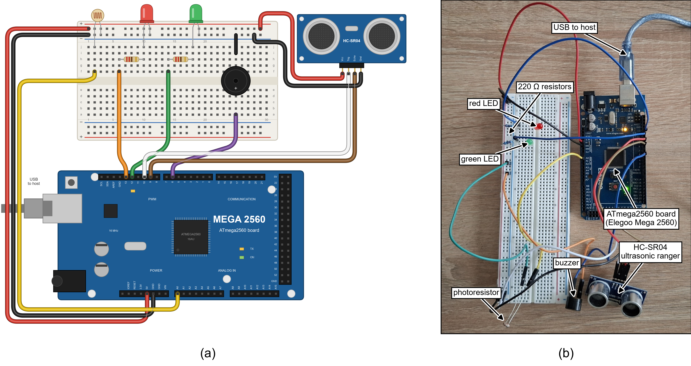

# Traffic Digital Twin: Falsified-Data Detection and Hardware Prototype

Code, firmware, raw results and figures for the article

> Low-Cost Electronic Prototype and Hybrid Detection Method for Traffic
> Digital Twins: Engineering Design, Implementation and Hardware Validation
> (submitted to Inventions, MDPI).

A traffic digital twin acts on telemetry from vehicles and roadside devices.
A compromised device keeps valid credentials, so its falsified readings pass
authentication. The article evaluates which detector design holds up against
an adaptive attacker and against attacks never seen in training, runs the
pipeline on a bench hardware prototype, and measures the cost of
post-quantum protection on two microcontrollers. This repository contains the
code, firmware, raw results and figures behind every number in the article.

## Contents

1. Key results and where they come from
2. Repository layout
3. Environment
4. Reproducing the results (four levels)
5. Article tables and figures mapped to files
6. Article sections mapped to commands
7. Notes on the hardware data
8. Known limitations
9. Data and licences
10. Citation and licence

## 1. Key results and where they come from

| Result | Value | File |
|---|---|---|
| Hybrid+ worst-case F1, all ten attack families, seeds 4 to 13 | 0.478 | results/ml/hybrid-plus-*.json |
| Hybrid+ on held-out seeds 14 to 23 | 0.474; beats the plain hybrid in 30 of 30 units (+0.025) | results/ml/hybrid-plus-confirm-*.json |
| Loss when a whole attack category is withheld | forest 14%, Hybrid+ 9% | results/ml/leave-category-out-*.json |
| VeReMi Extension F1 (seen, unseen type, unseen category) | Hybrid+ 0.796, 0.767, 0.756 | results/ml/veremi-benchmark.json |
| Kalman chi-squared test under adaptive attack | 0.162 | results/ml/sota-*.json |
| Live bench runs: rehearsed attacks detected | congestion spoof 83% and 88%, clear-road spoof 100% | results/hardware/live_2.csv, live_3.csv |
| Live bench runs: benign false alarms per message | 4.7% and 3.1% | results/hardware/live_2.csv, live_3.csv |
| ECDSA-P256 signing on the ATmega2560 | 4.69 s | results/hardware/crypto_mega.txt |
| ESP32: HMAC-SHA256, ML-KEM-768 keygen/encaps/decaps | 0.14 ms; 8.9, 10.3, 12.3 ms | results/hardware/crypto_esp32.txt |
| ESP32: ML-DSA-65 signing | mean 86 ms; 26.7% of 1,000 signatures exceed 100 ms | results/hardware/crypto_esp32.txt |

## 2. Repository layout

| Path | Contents |
|---|---|
| src/smart_city_security/ | Python package: twin, detectors, attacks, evaluation, hardware bridge |
| tests/ | Unit and integration tests (236) |
| scripts/ | One script per experiment (run_*.sh), result checks, live-run analysis, figure scripts |
| firmware/ | sensor_node (bench node), crypto_bench (ATmega2560), crypto_bench_esp32 (ESP32, PQClean), module_check |
| results/ml/ | Raw JSON output of every experiment in the article |
| results/hardware/ | Bench recordings, live-run logs, crypto timings |
| docs/ | Full experiment log (experiment6_avds.md), hardware results (hardware_testbed.md), wiring, figures and bench photos |
| data/processed/ | Small samples of each dataset in the project's telemetry schema |

## 3. Environment

The results were produced on Windows 10 (4-core Intel i5-8365U laptop) with
Python 3.14.4, scikit-learn 1.9.0 and NumPy 2.5.3. Any Python 3.11 or newer
works. For the exact package versions use the lock file.

    python -m venv .venv
    source .venv/bin/activate
    pip install -r requirements-lock.txt
    pip install -e ".[dev,sumo]"

On Windows activate the environment with .venv\Scripts\activate. The pqc
extra (pip install -e ".[pqc]") adds the liboqs post-quantum backend and
needs a liboqs installation with OQS_INSTALL_PATH set; it is only used for
the host-side post-quantum timings.

## 4. Reproducing the results

### Level 1: quick check, no downloads (about 5 minutes)

    pytest -q
    python scripts/make_v2_figures.py
    python scripts/make_system_figure.py
    python scripts/make_breadboard_figure.py
    python scripts/make_wiring_schematic.py
    python scripts/make_prototype_figures.py
    python scripts/analyse_live_run.py results/hardware/live_2.csv

Expected: 236 tests pass; Figures 5 to 7 are redrawn from results/ml/ and
Figures 1 to 4 from the scripts and the bench photos, all at 600 dpi into
docs/figures/; the live-run analysis prints 83.0% detection of the
congestion spoof, 100% of the clear-road spoof and a 4.7% benign
false-alarm rate.

### Level 2: rerun one experiment end to end, no downloads (about 10 minutes)

The SUMO data are generated locally and are bit-identical to the data used in
the article. Hybrid+ is then rerun for one seed and compared with the
committed result.

    export SCS_DATA_DIR=./datasets
    python -m smart_city_security.integration.sumo_scenario --out-dir datasets/sumo --out-csv datasets/sumo/sumo_fcd_full.csv --duration 2400 --vehicles-per-hour 1100
    python -m smart_city_security.integration.hybrid_plus --datasets sumo --seeds 4 --jobs 4 --output rerun-hybrid-plus-sumo.json
    python scripts/check_reproduction.py rerun-hybrid-plus-sumo.json results/ml/hybrid-plus-sumo.json

Expected: the SUMO file has 39,629 rows (MD5 da52128841131b345da69167fa91d972);
the Hybrid+ run takes about 7 minutes on 4 workers; the check prints
"units 1, values compared 80, mismatched 0". On Windows PowerShell set the
variable with $env:SCS_DATA_DIR = "./datasets".

The same check works for any other experiment: rerun it with fewer seeds and
compare the output with the committed file.

### Level 3: full reproduction (several days on a 4-core laptop)

Download the datasets (section 9), point SCS_DATA_DIR at them, then run the
scripts listed in section 6. Each script writes to results/ml/ and logs to
SCS_DATA_DIR/logs, and runs on JOBS parallel workers (default 4). All runs
use seeds 4 to 13 (confirmation runs: 14 to 23) and are deterministic for a
given seed.

### Level 4: hardware

All parts come from a standard Arduino starter kit. Single-unit retail
prices, October 2026 (Table 1 of the article):

| Part | Role | Price (USD) |
|---|---|---|
| ATmega2560 board (Elegoo Mega 2560 R3, with USB cable) | node controller | 19.99 |
| HC-SR04 ultrasonic ranger | position and speed | 4.24 |
| Photoresistor (GL5528) | occupancy (shadow gate) | 0.35 |
| Red and green 5 mm LEDs with two 220 ohm resistors | verdict indicators | 0.53 |
| Active buzzer (5 V) | alarm | 0.95 |
| Breadboard (830 points) | connections | 8.75 |
| Jumper wires (120 piece kit) | connections | 11.74 |
| Sensor node, total | | 46.55 |
| ESP32 board (DFRobot FireBeetle 2 ESP32-E) | cryptographic timing only | about 12 |

Pins: HC-SR04 Trig D10, Echo D9; photoresistor between A0 and GND (the
internal pull-up on A0 is enabled in code); red LED D13 and green LED D12,
each through 220 ohm; buzzer D6. The breadboard layout and the real build
are in docs/figures/fig_breadboard.png, the circuit schematic in
docs/figures/fig_wiring.png and the step by step wiring in
docs/hardware_wiring.md.

Firmware is built with arduino-cli: Arduino AVR core 1.8.8 for the
ATmega2560, Espressif ESP32 core 3.3.12 (board firebeetle32) for the ESP32.
The ATmega2560 sketches use the RTClib, MFRC522, Keypad, LiquidCrystal,
micro-ecc and Crypto libraries.

Bench node and live detection. Upload firmware/sensor_node, then record
benign traffic by moving an object along the bench track, train the model,
and run a live session with scheduled attacks (codes: 0 none, 1 congestion
spoof, 2 clear-road spoof, 4 identity spoof; durations in seconds):

    python -m smart_city_security.hardware.serial_bridge record --port COM8 --csv my_recording.csv --seconds 180
    python -m smart_city_security.hardware.serial_bridge fit --csv my_recording.csv --clock millis --model model.pkl
    python -m smart_city_security.hardware.serial_bridge live --port COM8 --clock millis --model model.pkl --schedule 0:30,1:30,0:30,2:30,0:30,4:30 --log my_live.csv
    python scripts/analyse_live_run.py my_live.csv

To reproduce the article's model exactly, train on
results/hardware/recording_occ.csv instead of a new recording.

Crypto benchmarks. Upload firmware/crypto_bench (ATmega2560) or
firmware/crypto_bench_esp32 (ESP32) and read the serial output at 115200
baud. The ESP32 prints CPU cycles: milliseconds = cycles / 240000.

## 5. Article tables and figures mapped to files

| Article | Source files in results/ |
|---|---|
| Table 1 (parts and prices) | section 4, level 4 of this file |
| Table 2 (attack families and categories withheld) | ml/leave-one-out-*.json, ml/leave-category-out-*.json |
| Table 3 (hybrid on known and novel families) | ml/hybrid-*.json, ml/hybrid-novel2-*.json, ml/novel-rf-*.json, ml/novel-unsup-*.json |
| Table 4 (established baselines and Hybrid+) | ml/sota-*.json, ml/hybrid-plus-*.json, ml/hybrid-*.json |
| Table 5 (held-out seeds 14 to 23) | ml/hybrid-plus-confirm-*.json |
| Table 6 (VeReMi Extension) | ml/veremi-benchmark.json |
| Table 7 (operating points) | ml/alarm-tradeoff-*.json, ml/plus-tradeoff-*.json, ml/plus-episodes-*.json |
| Table 8 (network impairment) | ml/hybrid-network-*.json, ml/plus-network-*.json |
| Table 9 (cryptographic cost) | hardware/crypto_mega.txt, hardware/crypto_esp32.txt |
| Table 10 (live bench runs) | hardware/live_2.csv (run 1), hardware/live_3.csv (run 2) |
| Figure 1 (system flow chart) | drawn by scripts/make_system_figure.py |
| Figure 2 (breadboard layout and assembled node) | drawn by scripts/make_breadboard_figure.py from docs/figures/photos/bench_daylight.jpg |
| Figure 3 (circuit schematic) | drawn by scripts/make_wiring_schematic.py |
| Figure 4 (live run during an attack) | drawn by scripts/make_prototype_figures.py from docs/figures/photos/bench_attack_esp32.jpg |
| Figure 5 (detectors) | ml/sota-*, ml/hybrid-*, ml/hybrid-confirm-*, ml/hybrid-novel2-*, ml/hybrid-plus-*, ml/hybrid-plus-confirm-* |
| Figure 6 (evaluation pitfalls) | ml/network-*.json (panel a), ml/supervised-*.json and ml/supervised-grid-*.json (panel b) |
| Figure 7 (alarm trade-off) | ml/alarm-tradeoff-*.json |

The figure files keep their working names: Figure 5 is fig5_detectors.png,
Figure 6 is fig7_pitfalls.png and Figure 7 is fig6_alarm_tradeoff.png.

The asterisk stands for the three sources: sumo, ngsim and pneuma.
docs/experiment6_avds.md gives the full tables per source and seed.

## 6. Article sections mapped to commands

| Article section | Command | Output in results/ml/ |
|---|---|---|
| 4.1 and 4.6 Supervised vs unsupervised, divergence | bash scripts/run_avds4.sh, run_avds_replace.sh, run_avds_kalman.sh | avds4-*.json |
| 4.2 Leave one family or category out | bash scripts/run_leave_one_out.sh, run_leave_category_out.sh | leave-one-out-*.json, leave-category-out-*.json |
| 4.2 Rehearsal composition | bash scripts/run_rehearsal_composition.sh | composition-*.json |
| 4.2 pNEUMA occupancy check | bash scripts/run_coupled_check.sh | coupled-check-pneuma.json |
| 4.3 Hybrid on novel attacks | bash scripts/run_novel_attacks.sh, run_hybrid_followups.sh | novel-*.json, hybrid-*.json |
| 4.4 Baselines and Hybrid+ | python -m smart_city_security.integration.sota_baselines, bash scripts/run_hybrid_plus.sh | sota-*.json, hybrid-plus-*.json |
| 4.5 VeReMi Extension | python -m smart_city_security.integration.veremi_benchmark --root PATH_TO_VEREMI | veremi-benchmark.json |
| 4.7 Gradient masking | bash scripts/run_grid_attacker.sh | supervised-grid-*.json |
| 4.8 and 4.9 Episodes, trade-off, network, poisoning | bash scripts/run_hybrid_plus_followups.sh, run_network_impairment.sh, run_avds_poisoning.sh | plus-*.json, network-*.json |
| 4.10 Link budget | python -m smart_city_security.evaluation.link_budget | printed table |
| 3.6 and 4.11 Hardware prototype | see section 4, level 4 | results/hardware/ |

## 7. Notes on the hardware data

- benign_1.csv to benign_4.csv are four three-minute recordings (6,077
  messages, joined in recording.csv). In sessions 1 and 2 the shadow gate's
  threshold was set too high and recorded no occupancy, so the model is
  trained on sessions 3 and 4 only (recording_occ.csv, 3,088 messages).
- live_1.csv is kept for transparency but is not used: during that run the
  firmware held its clock in a 32-bit float, which rounds an epoch time to
  128 s steps, so message times were wrong. The firmware was fixed (an
  unsigned integer clock) and old recordings are read with --clock millis,
  which stamps readings from the board's millisecond counter.
- live_2.csv and live_3.csv are the two runs reported in Table 10. Each line
  is message id, ground-truth attack code, alarm (0 or 1) and host scoring
  time in ms.
- The bench link is USB serial without cryptography; the cryptographic
  costs were measured separately on the boards (Table 9).
- The trained model (model.pkl) is not committed; the fit command above
  regenerates it.

## 8. Known limitations

- pNEUMA position is the distance from the session origin, modulo 1,000 m,
  not the path travelled; this affects the movement-consistency feature on
  pNEUMA.
- The bench prototype is one node with a hand-moved object; it shows that the
  pipeline runs on real sensors and timing, not a field evaluation.
- On VeReMi Extension the realised benign false-positive rate on test
  (0.09 to 0.12 for the forest-based detectors) exceeds the 5% set on
  training data.
- The ten attack families were designed by the authors; the withholding
  protocols and the VeReMi benchmark reduce but do not remove this concern.
- Energy per operation was not measured, and the post-quantum code is the
  portable PQClean reference C, not optimised for the ESP32.

## 9. Data and licences

The raw datasets are not redistributed. Download them into one folder and
point SCS_DATA_DIR at it (default ./datasets); folder layout in
data/raw/README.md.

| Dataset | Where to get it | Licence |
|---|---|---|
| NGSIM (Lankershim, Peachtree) | bash scripts/download_usdot_open_data.sh (U.S. DOT open data API) | public domain |
| pNEUMA | Zenodo record 10491409, https://zenodo.org/records/10491409 | CC BY 4.0 |
| VeReMi Extension | Zenodo record 20090854 | CC BY 4.0 |
| SUMO scenario | generated, see section 4, level 2 | generated |

## 10. Citation and licence

See CITATION.cff. Please cite the article once it is published.

Code and firmware: Apache License 2.0 (LICENSE).
firmware/crypto_bench_esp32/src/ contains PQClean code under its own licences
(see the LICENSE files there). The datasets keep their own licences.
